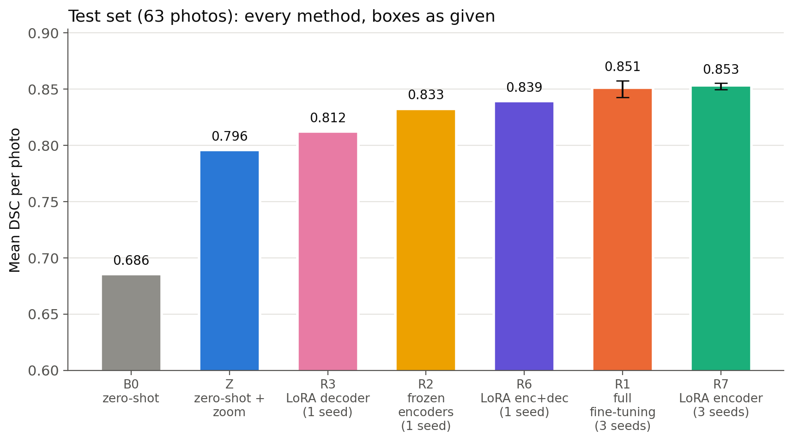
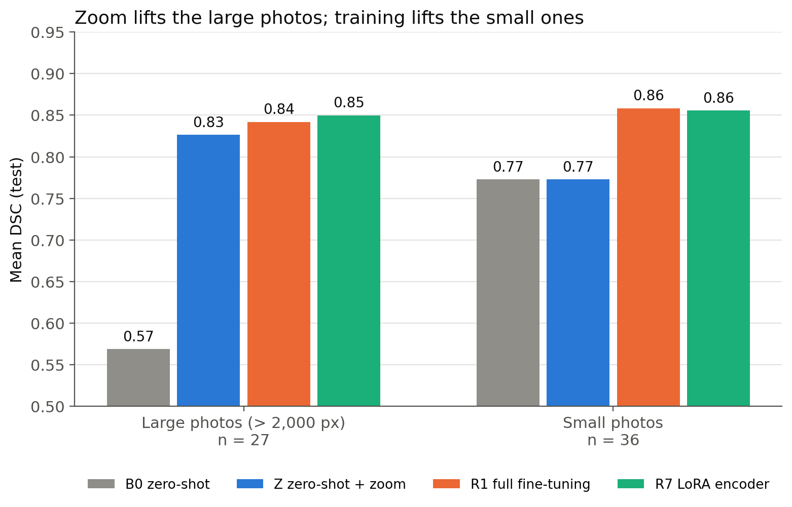
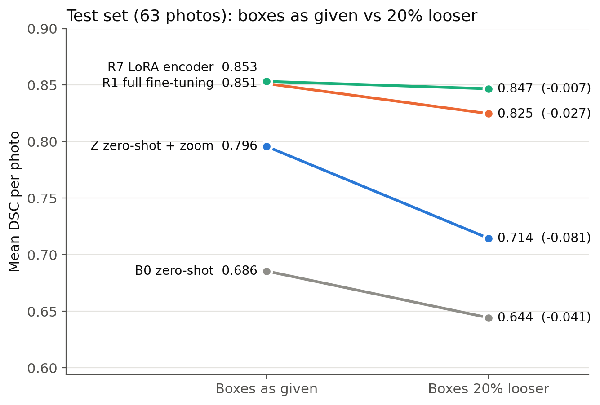
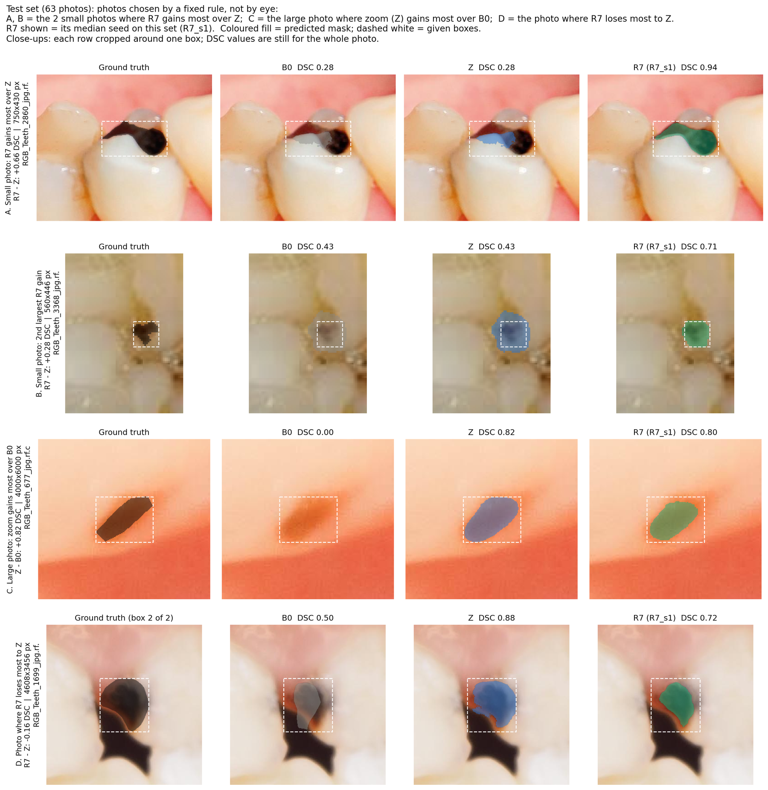
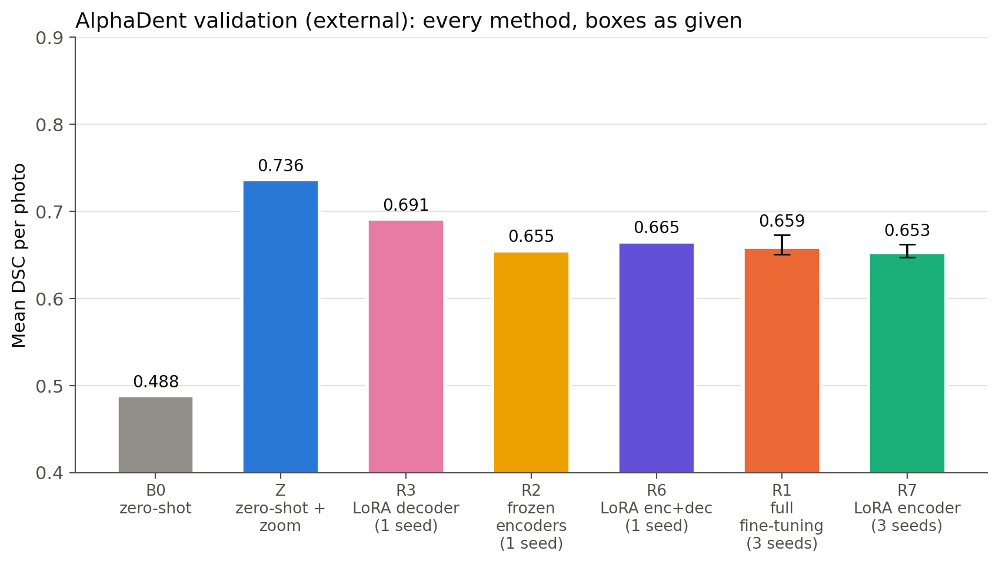
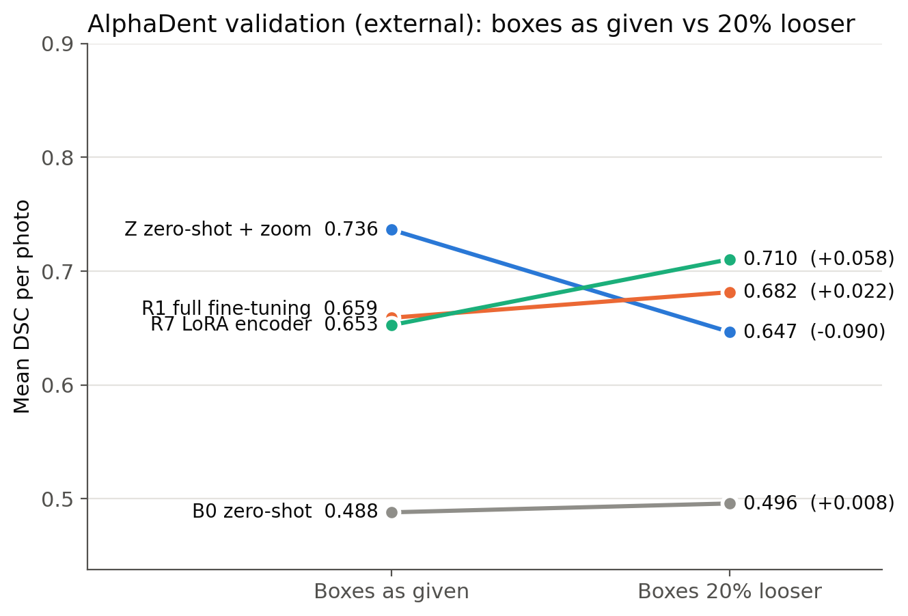
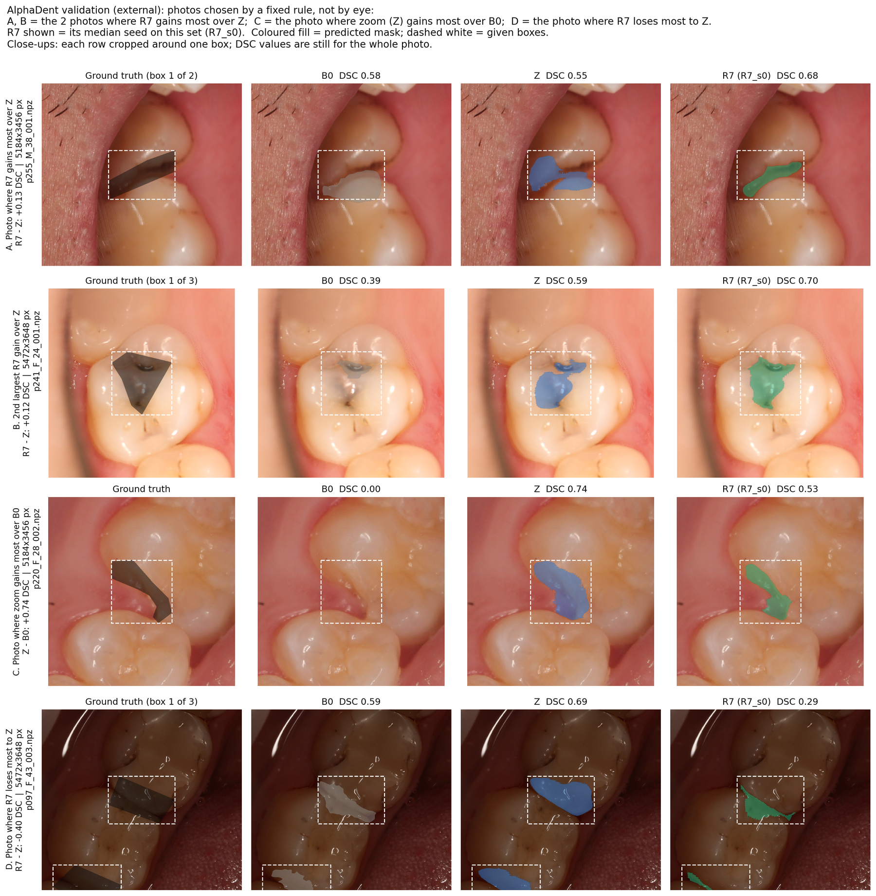
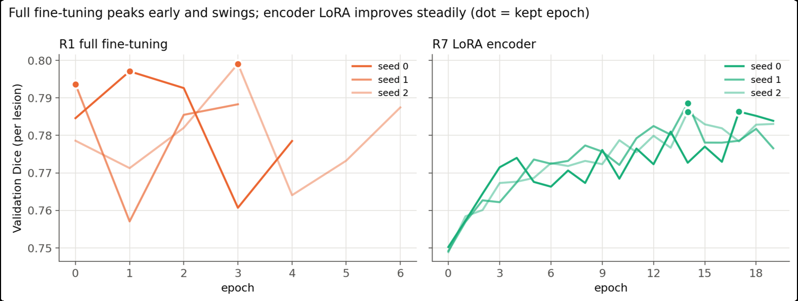

# Adapting LiteMedSAM to segment dental caries

Deep Learning course project, 2026 · Shelly Blumberg, Linoy Harush

Can a segmentation model trained on other medical domains be adapted to a new one with little data and a free GPU? We adapt **LiteMedSAM** (a 9.8 M-parameter distilled MedSAM) to **box-prompted segmentation of dental caries in intra-oral photos**: given one box per lesion, the model outlines the lesion. Everything was trained and evaluated on the free Google Colab tier (one T4 GPU).

This repository is a fork of the [LiteMedSAM branch of MedSAM](https://github.com/bowang-lab/MedSAM/tree/LiteMedSAM). Our code is added in `MedSAM/` next to the original files. The upstream README is kept as `MedSAM/README.md`.

## Main results (test set, 63 photos, mean DSC per photo)

Data: Roboflow "Dental Caries Segmentation" (caries, cavity and crack merged into one lesion class). 414 training photos with 1,278 lesions, 42 validation photos for every decision and 63 test photos for the final comparisons. Metrics: DSC (overlap) and NSD (outline within 2 px), computed per photo at full resolution and averaged over photos. The box of each lesion is given, so the results measure outlining, not detection.

| ID | Method | Trained weights | Test DSC | Test NSD | DSC, boxes 20% looser |
|---|---|---|---|---|---|
| - | Ellipse inside each box (no model, reference) | 0 | 0.735 | - | - |
| B0 | Zero-shot LiteMedSAM, whole photo | 0 | 0.686 | 0.740 | 0.644 |
| Z | Zero-shot + zoom (crop around each box in photos > 2,000 px) | 0 | 0.796 | 0.862 | 0.714 |
| R3 | LoRA r = 8, decoder attention q, v | 47,104 | 0.812 | 0.882 | 0.794 |
| R2 | Frozen encoders, full decoder | 4,058,340 | 0.833 | 0.902 | 0.799 |
| R6 | LoRA r = 8, encoder qkv + decoder | 106,496 | 0.839 | 0.907 | 0.830 |
| R1 | Full fine-tuning (3 seeds) | 9,791,300 | 0.851 ± 0.008 | 0.917 | 0.825 |
| **R7** | **LoRA r = 8, image encoder qkv only (3 seeds)** | **59,392** | **0.853 ± 0.003** | **0.918** | **0.847** |

- Zoom alone adds +0.11 DSC (+0.26 on large photos). Fine-tuning adds about +0.06 on top.
- Encoder LoRA (R7) equals full fine-tuning (R1) with 0.6% of the trained weights (paired Wilcoxon p = 0.69), with steadier seeds. With 20% looser boxes, R7 beats R1 on the test set (+0.022, p < 0.0001).
- Every trained model loses some accuracy on endoscopy images (Kvasir), LoRA adapters can be switched off to recover the original model.
- On an external dental dataset (AlphaDent, 64 photos), the fine-tuned models fall below zero-shot + zoom (R7 0.653 vs Z 0.736), because AlphaDent is labelled in a different style.

The full write-up is in the course report.

### Every method on the test set



R1 and R7 show the mean and the spread over 3 seeds. The other trained models have one seed.

### Where the gains come from



Zoom lifts the 27 large photos (long side above 2,000 px) from 0.57 to 0.83, and training adds only 0.01-0.02 there. On the 36 small photos zoom does not act, and training lifts them from 0.77 to 0.86.

### Robustness to looser boxes



Every box is loosened by 20% per side, with the same seeded boxes for every method. Zoom makes the untrained model more sensitive to loose boxes. Training with box jitter removes most of this. On validation, R7 and R1 lost the same amount, so R7's advantage here is a test-set result.

### Examples




### Forgetting on non-dental images (Kvasir)

| Change in DSC vs B0 | Kvasir-SEG polyps (B0 0.952) | Kvasir-Instrument (B0 0.917) |
|---|---|---|
| R1 full fine-tuning (3 seeds) | -0.086 | -0.101 |
| R2 frozen encoders | -0.073 | -0.056 |
| R7 LoRA encoder (3 seeds) | -0.065 | -0.008 (not significant) |
| R6 LoRA encoder + decoder | -0.040 | +0.018 (not significant) |
| R3 LoRA decoder | -0.034 | -0.011 |

Every model is compared with B0 per image (two-sided Wilcoxon, Holm-corrected). Kvasir images are below 2,000 px, so zoom never acts there and Z equals B0. The trained models draw smaller masks: on polyps, precision stays at 0.97-0.99 while recall falls from 0.92 to 0.78-0.86.

### External test: AlphaDent







The main comparison, fixed in advance, is R7 vs Z with the boxes as given: R7 is worse (0.653 vs 0.736, p < 0.0001), and every trained model falls below Z. Zoom still adds +0.25 over B0. With looser boxes the order flips (R7 0.710 vs Z 0.647), which we report as exploratory. AlphaDent's dentists outline the whole suspected area with coarse polygons. The trained models trace the visible stain inside them.

## Repository layout

| Path | What it is |
|---|---|
| `MedSAM/` | All code (ours and the original LiteMedSAM code) |
| `notebooks/` | Our Colab notebooks, with outputs cleared (see below) |
| `figures/` | The figures shown in this README |
| `MedSAM/splits/split_val42_test63.csv` | Our validation / test split (seed 2024) |

Our scripts in `MedSAM/`:

| Stage | Script | Purpose |
|---|---|---|
| Data | `preprocess_tooth_ds.py` | Roboflow COCO export → binary masks (caries, cavity, crack = 1, tooth = background) + `bboxes.json`, one box per connected lesion |
| | `pre_rgb_bbox_datasets.py`, `pre_rgb_bbox_train.py`, `prepare_training_npz.py` | Package photos, masks and boxes as `.npz` files for inference and training |
| | `split_val_test.py` | Stratified 42/63 validation/test split of the 105 test photos with lesions |
| | `count_unboxed_lesions.py`, `diagnose_bbox_survival.py` | Data checks: lesions without a box, and lesions that vanish when a photo is shrunk to 256 px |
| | `split_kvasir.py` | Splits Kvasir-SEG/Kvasir-Instrument into train/test folders by their official split files |
| | `prepare_alphadent.py` | AlphaDent (YOLO polygons) → the same layout, for the external test |
| Model | `train_one_gpu_multibox.py` | Trainer: one sample per lesion, zoom crops, box jitter, early stopping on validation, LoRA or full / partial fine-tuning |
| | `lora.py` | LoRA adapters for the image encoder and the mask decoder |
| | `export_infer_ckpt.py` | Turns a training checkpoint into an inference checkpoint (merges LoRA into the weights) |
| | `train_one_gpu.py`, `npz_to_npy.py` | LiteMedSAM's original trainer (with our LoRA flags), used only in the first training round |
| Inference | `infer_zoom.py` | Inference with zoom (`-zoom_above 2000`) and optional looser boxes (`-box_perturb 0.2`) |
| Evaluation | `eval_run.py`, `evaluation/compute_metrics_binary.py` | Per-photo DSC and NSD (τ = 2 px) at full resolution, on binarised masks |
| | `compare_paired.py` | Paired per-photo comparison of two runs: sign test and Wilcoxon |
| Colab | `colab_runs.py`, `colab_extras.py`, `colab_figures.py` | Helpers that run every experiment, table and figure from the notebook |

## Notebooks

`notebooks/` holds the Colab notebooks we ran, with their outputs cleared to keep the files small. The commands in this README are taken from them and from the helper modules they call.

| Notebook | What it covers |
|---|---|
| `LiteMedSAM_Baseline_production.ipynb` | Session setup. The Kvasir first attempt (download, split, preprocessing, zero-shot scoring). Dental data preparation. Zero-shot B0 and the binary-metric fix. The first training round (F1, F2, LoRA r = 8 / r = 4). The 42 / 63 split. The zero-shot zoom test and the box-robustness test |
| `LiteMedSAM_train_runs1.ipynb` | The trainer's trial run (2 epochs on 20 photos, resume, LoRA export). Runs R2_s0, R6_s0, R7_s1, R1_s1, R1_s2. The R7-extension check (not needed). The learning-rate check (R4d, R4e) |
| `LiteMedSAM_train_runs2.ipynb` | Runs R3_s0, R1_s0, R7_s0 and R7_s2 (its R1_s2 cell was interrupted, the reported R1_s2 is in `train_runs1`) |
| `LiteMedSAM_infer_test.ipynb` | The test set: B0, Z and every model, the comparison tables and R7 vs R1. All figures. Zoom after training, inference cost and error analysis. The Kvasir forgetting test. Mask size. Box-only baselines and IoU |
| `LiteMedSAM_AlphaDent.ipynb` | The external test: AlphaDent download, conversion and checks, scoring every model, tables, figures and the follow-up checks |

Each notebook starts with the same setup cells (mount Drive, pull the repo with a GitHub token from Colab Secrets, `pip install -e .`, set the git identity). The names and email addresses in the git-identity cells are replaced by `<your-name>` and `<your-email>`.

Some cells are marked "DONT RUN THIS" or "Failed cell": they are kept as a record of what we tried and are not part of the pipeline.

## Setup

Tested on Google Colab (free tier, T4 GPU, Python 3, the preinstalled PyTorch). Training needs a GPU. Inference and scoring also run on CPU.

```bash
git clone https://github.com/LinoyHarush/MedSAM_enh.git
cd MedSAM_enh/MedSAM
pip install -e .          # installs monai, timm, opencv, scipy, pandas, ... (see setup.py)
```

Download the pretrained LiteMedSAM checkpoint `lite_medsam.pth` (link in `MedSAM/work_dir/LiteMedSAM/README.md`) into `MedSAM/work_dir/LiteMedSAM/`.

`data/`, `experiments/` and all checkpoints (`*.pth`) are not in git. In our runs they live in a shared Google Drive folder with the same layout as below.

## Reproducing the results

`ROOT` is the project folder that holds `data/` and `experiments/` (on Colab, the Drive copy of this repo, `/content/drive/MyDrive/Deep_Learning_Course/MedSAM/MedSAM_enh`). Data preparation (step 1) runs from `ROOT`, as in our notebook. Everything after it runs from `ROOT/MedSAM`.

### 1. Dental data

Download version 3 of the Roboflow Universe "Dental Caries Segmentation" dataset (661 photos, CC BY 4.0). Our export was `Dental_Caries_Segmentation.v3i.sam2.zip`. It contains `train/` (529 photos) and `test/` (132 photos), each with its photos and a COCO `_annotations.coco.json` with four classes: caries, cavity, crack and tooth.

```bash
cd $ROOT
unzip -q data/Dental_Caries_Segmentation.v3i.sam2.zip -d data/Dental_Caries_Segmentation/
# the later cells read the lowercase folder name, so rename it if your file system is case-sensitive
mv data/Dental_Caries_Segmentation data/dental_caries_segmentation

# binary masks (caries, cavity, crack = 1, tooth = background) + bboxes.json, one box per lesion, per split
python MedSAM/preprocess_tooth_ds.py \
  --json_path data/dental_caries_segmentation/train/_annotations.coco.json \
  --img_dir data/dental_caries_segmentation/train \
  --out_dir data/dental_caries_segmentation_processed/train/
python MedSAM/preprocess_tooth_ds.py \
  --json_path data/dental_caries_segmentation/test/_annotations.coco.json \
  --img_dir data/dental_caries_segmentation/test \
  --out_dir data/dental_caries_segmentation_processed/test/

# npz files for inference: MedSAM_test/RGB_Teeth/{imgs,gts} (and MedSAM_train/RGB_Teeth)
python MedSAM/pre_rgb_bbox_datasets.py \
  -output_path data/dental_caries_segmentation_processed \
  -modality RGB -anatomy Teeth -img_name_suffix .jpg -gt_name_suffix .png -bbox_format json \
  -train_img_path data/dental_caries_segmentation_processed/train/images \
  -train_gt_path data/dental_caries_segmentation_processed/train/masks \
  -train_bbox_json data/dental_caries_segmentation_processed/train/bboxes.json \
  -test_img_path data/dental_caries_segmentation_processed/test/images \
  -test_gt_path data/dental_caries_segmentation_processed/test/masks \
  -test_bbox_json data/dental_caries_segmentation_processed/test/bboxes.json \
  --binary_mask

# npz files for training: imgs, gts and boxes in one file per photo
P=data/dental_caries_segmentation_processed
python MedSAM/pre_rgb_bbox_train.py \
  -img_path $P/train/images -gt_path $P/train/masks \
  -bbox_format json -bbox_json $P/train/bboxes.json \
  -output_path $P/MedSAM_train/RGB_Teeth/train_ready_npz \
  -modality RGB -anatomy Teeth -img_name_suffix .jpg -gt_name_suffix .png --binary_mask
```

Photos without lesions are dropped: `pre_rgb_bbox_datasets.py` prints `saved 414 cases, skipped 115` for the training split, and `pre_rgb_bbox_train.py` `Saved 414 training-ready npz files` (1,278 lesions). 105 test photos remain.

```bash
# 42 validation / 63 test photos, stratified by photo size and number of lesions (seed 2024 by default)
python MedSAM/split_val_test.py -test_dir $P/MedSAM_test/RGB_Teeth -out_root data
```

This writes `data/split_val42_test63.csv`, `data/dental_caries_val42/` (with `train_ready_npz/` for the trainer's validation) and `data/dental_caries_test63/`. The split we used is also in `MedSAM/splits/split_val42_test63.csv`. Any `segs_*` prediction folders already in the test folder are split along with the photos, so earlier runs can be re-scored on each part without new inference.

### 2. Reference models (without training): B0 and Z

From here on, run from `ROOT/MedSAM`.

```bash
cd $ROOT/MedSAM
DS=dental_caries_val42                 # or dental_caries_test63
T=$ROOT/data/$DS/MedSAM_test/RGB_Teeth
CK=work_dir/LiteMedSAM/lite_medsam.pth
# B0: the original whole-photo pipeline (CVPR24_LiteMedSAM_infer.py, then binary DSC/NSD)
python eval_run.py --run_name og_ckpt --ckpt $CK --repo $ROOT --dataset $DS
# Z: zoom on photos whose long side is above 2,000 px. -reference_dir checks that unzoomed photos equal B0
python infer_zoom.py -i $T/imgs -o $T/segs_Z -lite_medsam_checkpoint_path $CK \
    -zoom_above 2000 -reference_dir $T/segs_og_ckpt -device cpu
python eval_run.py --run_name Z --ckpt $CK --repo $ROOT --dataset $DS
# both with every box 20% looser (the same seeded boxes for every method)
# -zoom_above 100000 = whole photo, as B0
for N in B0:100000 Z:2000
do
  python infer_zoom.py -i $T/imgs -o $T/segs_${N%%:*}_p20 -lite_medsam_checkpoint_path $CK \
      -zoom_above ${N##*:} -box_perturb 0.2 -perturb_seed 0 -device cpu
  python eval_run.py --run_name ${N%%:*}_p20 --ckpt $CK --repo $ROOT --dataset $DS
done
```

`eval_run.py` reuses the predictions in `segs_<run_name>/` when all of them exist. Otherwise it runs the old whole-photo inference. So for any zoomed run, always run `infer_zoom.py` first. `eval_run.py` writes a converted checkpoint to `--tmp_dir` (default `/content/infer_ckpts`, pass another folder outside Colab).

### 3. Training

```bash
RUN=R7_s0
python train_one_gpu_multibox.py \
    -train_npz_dir $ROOT/data/dental_caries_segmentation_processed/MedSAM_train/RGB_Teeth/train_ready_npz \
    -val_npz_dir $ROOT/data/dental_caries_val42/train_ready_npz \
    -pretrained_checkpoint $CK -work_dir runs/$RUN -seed 0 \
    --use_lora --lora_scope image_encoder
python export_infer_ckpt.py -ckpt runs/$RUN/medsam_lite_multibox_best_val.pth -out runs/${RUN}_infer.pth
```

Flags per method (everything else is the trainer's default for that run type):

| ID | Flags | Epoch cap / patience / lr (defaults) |
|---|---|---|
| R1 | *(none)* | 10 / 3 / 5e-5 |
| R2 | `--freeze_image_encoder --freeze_prompt_encoder` | 15 / 4 / 5e-5 |
| R3 | `--use_lora --lora_scope mask_decoder` | 20 / 5 / 1e-4 |
| R6 | `--use_lora --lora_scope both` | 20 / 5 / 1e-4 |
| R7 | `--use_lora --lora_scope image_encoder` | 20 / 5 / 1e-4 |
| R4d, R4e | R3 / R7 flags plus `-lr 5e-4` (learning-rate check) | |

Shared defaults: LoRA r = 8, α = 16, dropout 0.05. Zoom crops for photos above 2,000 px (`-zoom_above 2000 -margin 0.5 -min_crop 256`). Box jitter 0-20% per side (`-bbox_shift_frac 0.2`) and random flips. AdamW (weight decay 0.01), batch size 4. Loss Dice + BCE + IoU MSE. The best epoch by validation per-lesion Dice, with early stopping. We used seeds 0, 1 and 2 for R1 and R7, and seed 0 for the others.

### 4. Scoring a trained run

```bash
INF=runs/${RUN}_infer.pth
# boxes as given
python infer_zoom.py -i $T/imgs -o $T/segs_$RUN -lite_medsam_checkpoint_path $INF -zoom_above 2000 -device cuda
python eval_run.py --run_name $RUN --ckpt $INF --repo $ROOT --dataset $DS
# every box 20% looser (the same seeded boxes as for B0 and Z)
python infer_zoom.py -i $T/imgs -o $T/segs_${RUN}_p20 -lite_medsam_checkpoint_path $INF -zoom_above 2000 \
    -box_perturb 0.2 -perturb_seed 0 -device cuda
python eval_run.py --run_name ${RUN}_p20 --ckpt $INF --repo $ROOT --dataset $DS
# paired per-photo comparison with Z (sign test + Wilcoxon. Rule: sign p <= 0.05 and mean gain >= 0.03)
python compare_paired.py -candidate $ROOT/experiments/$DS/$RUN/metrics_per_case.csv \
    -reference $ROOT/experiments/$DS/Z/metrics_per_case.csv -split_csv $ROOT/data/split_val42_test63.csv
```

Scores are written to `experiments/<dataset>/<run>/metrics_per_case.csv` and `summary.json`. Set `DS=dental_caries_test63` for the test set.

### 5. On Colab: the exact cells we ran

The steps above are wrapped in the helper modules `MedSAM/colab_runs.py` (`cr`), `MedSAM/colab_extras.py` (`cx`) and `MedSAM/colab_figures.py` (`cf`). These are the cells we ran, in order, copied from the notebooks in `notebooks/`.

**Session setup** (every session, after the setup cells at the top of each notebook. Training needs a T4 GPU runtime, everything else also runs on CPU):

```python
%cd /content
REPO_D = "/content/drive/MyDrive/Deep_Learning_Course/MedSAM/MedSAM_enh"   # this repo's folder on Google Drive
!mkdir -p /content/code/MedSAM /content/work/data /content/work/experiments /content/train_ready_npz /content/runs
!rsync -a --exclude='work_dir' --exclude='__pycache__' "{REPO_D}/MedSAM/" /content/code/MedSAM/
!cp "{REPO_D}/MedSAM/work_dir/LiteMedSAM/lite_medsam.pth" /content/lite_medsam.pth

import sys
sys.path.insert(0, "/content/code/MedSAM")
import colab_runs as cr
cr.init(REPO_D)
cr.copy_data()        # training sessions only: 414 training and 42 validation npz files to the runtime's disk
```

**Training runs on validation** (`LiteMedSAM_train_runs1.ipynb`, `LiteMedSAM_train_runs2.ipynb`). Each run gets a new name `<method>_s<seed>`, and `cr.train` and `cr.save` refuse to overwrite an existing name.

```python
run = cr.train("R7", 0)                 # train + export the inference checkpoint (R1, R2, R3, R6, R7. Later: R4d, R4e)
cr.score(run, cr.infer_ckpt(run))       # zoom inference + eval_run, boxes as given and 20% looser
cr.save(run)                            # copy this run's results back to Drive
cr.compare(run)                         # per-photo comparison with Z: all/large/small photos
cr.board()                              # every run on Drive in one table (experiments/dental_caries_val42/board.csv)
```

Runs: Seed 0 of R1, R2, R3, R6 and R7. Seeds 1 and 2 of R1 and R7. The learning-rate check `cr.train("R4d", 0)` (R3 at lr 5e-4) and `cr.train("R4e", 0)` (R7 at lr 5e-4). The rule for extending R7 (`cr.capped`, `cr.extend`) said not to extend, so no extension was run.

**Test set** (`LiteMedSAM_infer_test.ipynb`, skip `cr.copy_data()` in the setup):

```python
TS = cr.TEST              # "dental_caries_test63"
RUNS = ["R1_s0", "R1_s1", "R1_s2", "R7_s0", "R7_s1", "R7_s2", "R2_s0", "R3_s0", "R6_s0"]
cr.copy_test_data(RUNS)    # test photos, B0's scores and the checkpoints
cr.score("Z", cr.OG, ds=TS)   # Z, boxes as given and 20% looser
cr.score("B0", cr.OG, ds=TS, zoom_above=100000, variants=("p20",))   # B0 with looser boxes (whole photo)
cr.save("Z", TS, trained=False)
cr.save("B0", TS, trained=False, variants=("p20",))
for r in RUNS:
    cr.score(r, cr.infer_ckpt(r), ds=TS)
    cr.save(r, TS, trained=False)
cr.test_table(["R1_s0", "R2_s0", "R3_s0", "R6_s0", "R7_s0"], out_name="test_comparison_seed0.csv")   # seed-0 models vs Z and B0
cr.final_table({"R1": ["R1_s0", "R1_s1", "R1_s2"], "R7": ["R7_s0", "R7_s1", "R7_s2"]})   # mean plus-minus sd over seeds
cr.test_table(["R1_s0", "R1_s1", "R1_s2", "R7_s0", "R7_s1", "R7_s2"], out_name="test_comparison_final.csv")
```

We scored the test set in two rounds: the seed-0 models first, then seeds 1 and 2, whose comparison was fixed before the first round's results were seen. Running all models at once, as above, gives the same scores.

R7 vs R1 (fixed in advance): each photo's DSC averaged over the 3 seeds of each method, then a two-sided Wilcoxon test.

```python
from compare_paired import summarize
def seed_mean(runs, suf=""):
    m = None
    for r in runs:
        d = cr.load(r + suf, TS)[["case", "dsc"]].rename(columns={"dsc": r})
        m = d if m is None else m.merge(d, on="case")
    return m.set_index("case").mean(axis=1)
R7, R1 = ["R7_s0", "R7_s1", "R7_s2"], ["R1_s0", "R1_s1", "R1_s2"]
for suf, label in [("", "as given (main)"), ("_p20", "20% looser")]:
    a, b = seed_mean(R7, suf), seed_mean(R1, suf)
    k = summarize((a - b.loc[a.index]).to_numpy(), 0.03, 0.05)
    print(f"R7 vs R1, {label}: DSC {a.mean():.3f} vs {b.mean():.3f} | wins/losses {k['wins']}/{k['losses']} | "
          f"mean {k['mean_diff']:+.3f} | Wilcoxon p {k['wilcoxon_p']:.4f}")
```

**Figures and the method table** (saved in `experiments/dental_caries_test63/figures/`):

```python
import importlib, colab_figures as cf, colab_extras as cx
cf.method_table()               # weights, epochs, training time, validation/test DSC and NSD, looser boxes
cf.fig_overview()               # every method on test
cf.fig_size_groups()            # large vs small photos
cf.fig_robustness()             # boxes as given vs 20% looser
cf.fig_training_curves()        # validation Dice per epoch, R1 vs R7, 3 seeds each
cf.fig_examples(closeup=True)   # 4 photos chosen by a fixed rule, cropped around one box
```

**Follow-up analyses** (test set, Kvasir and reference baselines):

```python
cx.zoom_ablation()                     # is zoom still needed after training? (R1, R7 without zoom: <run>_nozoom)
cx.inference_cost()                    # seconds per photo for B0, Z, R7 and R1, one session
cx.error_analysis()                    # where R7 still fails
cx.error_by_seen_size()                # R7's DSC vs lesion size as R7 saw it
cx.forgetting_score("kvasir_seg")      # every model on Kvasir-SEG
cx.forgetting_table("kvasir_seg")      # every model vs B0
cx.forgetting_score("kvasir_instruments")
cx.forgetting_table("kvasir_instruments")
cx.b0_reproduce("kvasir_instruments")  # the new B0 equals the earlier B0
cx.b0_reproduce("kvasir_seg")
cx.mask_bias("kvasir_seg")             # mask size, precision, recall
cx.mask_bias("kvasir_instruments")
cx.mask_bias(cr.TEST, ["og_ckpt", "Z", "R1_s0", "R1_s1", "R1_s2", "R7_s0", "R7_s1", "R7_s2"])
cr.copy_test_data([])
cx.box_baselines(cr.VAL)               # filled box and inscribed ellipse scored as masks
cx.box_baselines(cr.TEST)
cx.iou_table(cr.VAL)                   # IoU per photo and pooled
cx.iou_table(cr.TEST)
```

### 6. Additional datasets beyond the dental dataset we trained on

- **Forgetting on Kvasir-SEG and Kvasir-Instrument** (our first attempt, later the forgetting test). Download both from Simula (`https://datasets.simula.no/downloads/kvasir-instrument.zip` and `https://datasets.simula.no/downloads/kvasir-seg.zip`) and unzip them into `data/kvasir_instruments/` and `data/kvasir_seg/`. Kvasir-Instrument's photos and masks come as `images.tar.gz` and `masks.tar.gz`, extracted in place with `tar -xzf`. Then copy the photos, masks and boxes listed in each dataset's official split files into `train/` and `test/` subfolders, each with `images/`, `masks/` and its boxes. Kvasir-Instrument uses `train.txt`/`test.txt` (472/118 images, boxes in `bounding_boxes.json`). Kvasir-SEG uses `train.txt`/`val.txt` (880/120 images, one box CSV per image in `bbox/`). The 120 `val.txt` images form its `test/` folder. Then, from `ROOT`:
  ```bash
  python MedSAM/split_kvasir.py -data_dir data/kvasir_instruments                # train/, test/ with bounding_boxes.json
  python MedSAM/split_kvasir.py -data_dir data/kvasir_seg -rename val=test       # train/, and val.txt -> test/, with bbox/*.csv
  python MedSAM/pre_rgb_bbox_datasets.py -output_path data/kvasir_instruments -modality RGB -anatomy KvasirInstruments \
    -img_name_suffix .jpg -gt_name_suffix .png -bbox_format json \
    -train_img_path data/kvasir_instruments/train/images -train_gt_path data/kvasir_instruments/train/masks \
    -train_bbox_json data/kvasir_instruments/train/bounding_boxes.json \
    -test_img_path data/kvasir_instruments/test/images -test_gt_path data/kvasir_instruments/test/masks \
    -test_bbox_json data/kvasir_instruments/test/bounding_boxes.json --binary_mask
  python MedSAM/pre_rgb_bbox_datasets.py -output_path data/kvasir_seg -modality RGB -anatomy KvasirSeg \
    -img_name_suffix .jpg -gt_name_suffix .jpg -bbox_format csv_dir \
    -train_img_path data/kvasir_seg/train/images -train_gt_path data/kvasir_seg/train/masks \
    -train_bbox_csv_dir data/kvasir_seg/train/bbox \
    -test_img_path data/kvasir_seg/test/images -test_gt_path data/kvasir_seg/test/masks \
    -test_bbox_csv_dir data/kvasir_seg/test/bbox --binary_mask
  ```
  `split_kvasir.py` is adapted from the split helper in `notebooks/LiteMedSAM_Baseline_production.ipynb`. The Kvasir-Instrument split was made with an earlier version of the same helper.
  Every model is then scored with `colab_extras.forgetting_score()` and compared with B0 with `forgetting_table()` (section 5). Our first-attempt B0 on Kvasir-Instrument (DSC 0.905) used the original multi-label `evaluation/compute_metrics.py`. The 0.917 we report uses `compute_metrics_binary.py` on the same, pixel-identical predictions.
- **External test on AlphaDent** (Sosnin et al. 2025, Zenodo record 16582489, CC BY 4.0): DSLR intra-oral photos from another clinic. Inference only: nothing is trained, tuned or chosen on it. Its test labels are closed, so we use the labelled `valid` split. The binary target is built like ours: the six caries classes (ids 3-8) are foreground, while abrasion, filling and crown (0-2) are background. We use one box per caries polygon. The cells, from `notebooks/LiteMedSAM_AlphaDent.ipynb` (session setup as in section 5, without `cr.copy_data()`):
  ```python
  import importlib, colab_extras as cx, colab_figures as cf
  AD = "alphadent_valid"
  # list the files in the Zenodo record
  import requests
  rec = requests.get("https://zenodo.org/api/records/16582489", timeout=60).json()
  for f in rec["files"]:
      print(f["key"], f"{f['size'] / 1e9:.2f} GB")  
      # one archive, AlphaDent.zip, 4.88 GB
  # download the archive once (a copy is kept on Drive in data/raw/alphadent/) and unzip it on the runtime's disk
  import os
  RAW_D = f"{REPO_D}/data/raw/alphadent"
  os.makedirs(RAW_D, exist_ok=True)
  os.makedirs("/content/alphadent_raw", exist_ok=True)
  for f in [f for f in rec["files"] if f["key"].endswith(".zip")]:
      local = f"/content/alphadent_raw/{f['key']}"
      if os.path.exists(f"{RAW_D}/{f['key']}"):                       # already on Drive: copy, don't download
          cr.sync(f"{RAW_D}/{f['key']}", "/content/alphadent_raw/")
      else:
          cr.sh(f'wget -q --show-progress -O "{local}" "{f["links"]["self"]}"')
          cr.sync(local, f"{RAW_D}/")                                   # keep the archive on Drive
      cr.sh(f'unzip -q -o "{local}" -d /content/alphadent')
  # check that classes 3-8 are the six caries classes, from the dataset's .yaml
  import glob, yaml
  print(yaml.safe_load(open(glob.glob("/content/alphadent/**/*.yaml", recursive=True)[0]))["names"])
  # convert the valid split to our layout
  cr.sh("cd /content/code/MedSAM && python prepare_alphadent.py -src /content/alphadent -split valid -out_root /content/work/data")
  cx.check_alphadent("/content/alphadent", ds=AD, split="valid")   # checks the conversion before any model is run
  cx.score_set(AD, cx.alphadent_plan())     # B0, Z and every model, boxes as given and 20% looser
  ALL = ["R1_s0", "R1_s1", "R1_s2", "R7_s0", "R7_s1", "R7_s2", "R2_s0", "R3_s0", "R6_s0"]
  cr.test_table(ALL, ds=AD, out_name="alphadent_comparison.csv")   # every model vs Z and vs B0 (Holm)
  cr.final_table({"R1": ALL[:3], "R7": ALL[3:6]}, ds=AD)
  cx.r7_vs_r1(AD)
  cf.fig_overview(AD)
  cf.fig_robustness(AD)
  cf.fig_examples(AD, closeup=True)
  cx.mask_bias(AD, ["og_ckpt", "Z", "Z_p20", "R1_s0", "R1_s1", "R1_s2", "R7_s0", "R7_s1", "R7_s2",
                    "R7_s0_p20", "R7_s1_p20", "R7_s2_p20"])
  cx.box_baselines(AD)
  cx.iou_table(AD)
  ```
  Expected from the conversion: 83 photos read, 64 with caries written, 19 without caries skipped, 258 caries boxes (the paper's caries count on `valid`), every photo above 2,000 px. `check_alphadent` must show: no EXIF-rotated photo (YOLO labels refer to the stored pixel grid), 0 label coordinates outside [0, 1], 0 boxes without caries pixels, and an overlay figure (`experiments/alphadent_valid/figures/check_conversion.png`) with every mask inside its box. Unzipped files and converted photos live only on the runtime's disk (several GB). Results go to `experiments/alphadent_valid/` on Drive.

### 7. The first training round (original trainer, reported as the baseline attempt)

Before the fixes described in the report, we trained with LiteMedSAM's original `train_one_gpu.py` on whole photos: one box drawn around all lesions of a photo, no validation set, and the checkpoint with the lowest training loss. None of these runs beat zero-shot. To reproduce them, from `ROOT/MedSAM`:

```bash
T=$ROOT/data/dental_caries_segmentation_processed/MedSAM_train/RGB_Teeth
python npz_to_npy.py -npz_dir $T/train_ready_npz -npy_dir $T/npy -num_workers 4     # drops the stored boxes
# F1: frozen image and prompt encoders (scored as frz_20e). -num_epochs 20 runs epochs 1-19, the old trainer skips epoch 0
python train_one_gpu.py -data_root $T/npy -pretrained_checkpoint $CK -work_dir work_dir \
  -num_workers 4 -batch_size 4 -num_epochs 20 --freeze_image_encoder --freeze_prompt_encoder
# F1 wrote into work_dir/. Its checkpoints were then kept in work_dir/cont_og_frz_20e/, the folder F2 and scoring read
# F2: F1 continued to 40 epochs (scored as frz_40e)
python train_one_gpu.py -data_root $T/npy -pretrained_checkpoint $CK -resume work_dir/cont_og_frz_20e/medsam_lite_best.pth \
  -work_dir work_dir/cont_frz_20e_frz_20e-40e -num_workers 2 -batch_size 4 -num_epochs 40 \
  --freeze_image_encoder --freeze_prompt_encoder
# L1 / L2: LoRA in the decoder (q, v), r = 8 and r = 4 (scored as lora_qv_r8, lora_qv_r4)
for R in 8 4
do
  python train_one_gpu.py -data_root $T/npy -pretrained_checkpoint $CK -work_dir work_dir/exp_frz_base_msk_decoder_lora_qv_r$R \
    -num_workers 2 -batch_size 4 -num_epochs 20 --use_lora --lora_scope mask_decoder --lora_targets q,v \
    --lora_r $R --lora_alpha 16 --lora_dropout 0.05
done
# score each run's medsam_lite_best.pth on the 105 test photos, and later on each part of the split
python eval_run.py --run_name frz_20e --ckpt work_dir/cont_og_frz_20e/medsam_lite_best.pth --repo $ROOT
```

The r = 4 run was interrupted and resumed into `work_dir/exp_frz_base_msk_decoder_lora_qv_r4_resume` (`-resume work_dir/exp_frz_base_msk_decoder_lora_qv_r4/medsam_lite_latest.pth --lora_checkpoint work_dir/exp_frz_base_msk_decoder_lora_qv_r4/medsam_lite_lora_latest.pth`). `eval_run.py` defaults to `--dataset dental_caries_segmentation_processed`, the 105 test photos before the split.

Results on the 105 test photos (DSC): zero-shot 0.695, F1 0.699, F2 0.677, LoRA r = 8 0.680, LoRA r = 4 0.672. **Three lessons from these runs led to the pipeline above:** choose on a validation set, train on the prompt used at test time (one box per lesion), and stop large photos from erasing lesions when shrunk to 256 px (zoom).

## Reproducibility notes

- **Seeds:** split seed 2024 for validation set creation. Training seeds 0, 1, and 2. Looser-box seed 0, the same for every method.
- **Decisions on validation only:** zoom, the jitter level, epochs and which runs got more seeds were all decided on the 42 validation photos, with rules written down before the results were seen. The 63 test photos were used only for comparisons fixed in advance. The rules we fixed:
  - *Zoom:* a photo-size group is zoomed only if, on validation, zoom beats B0 with a one-sided sign test p ≤ 0.05 **and** a mean DSC gain ≥ 0.03. Large photos passed (+0.26), small photos did not (+0.01), hence `-zoom_above 2000`.
  - *Box jitter:* raise the training jitter if B0 or Z lose more than 0.05 DSC with 20% looser boxes on validation. Both did, hence `-bbox_shift_frac 0.2`.
  - *Training runs:* a run passes against Z with the same sign-test-and-0.03 rule. The two best methods on validation (R1, R7) got seeds 1 and 2. R7 would be extended only if both new seeds hit the epoch cap while still improving, and neither did.
  - *Test set and external sets, comparisons fixed before scoring:* R7 vs R1 (per-photo means of 3 seeds, two-sided Wilcoxon), zoom after training (R7, large photos), every model vs B0 on Kvasir, and R7 vs Z on AlphaDent. Analyses decided after seeing results are reported as exploratory.
- **No overwriting:** `colab_runs.py` refuses to create or save a run whose name already exists, so every result keeps its own folder.
- **Timing:** free-tier Colab speed varies by about 20% between sessions. R7 trains in about 58 min per run, R1 in about 23 min. R7 takes longer because it runs the full 20 epochs: with only 59k trainable weights it keeps improving until epochs 14-17 and does not overfit. R1 trains all 9.8M weights on 414 training photos, a large number of parameters for a dataset this size. Its validation Dice peaks at epochs 0-3 and then drops (it overfits), so early stopping ends it after 4-7 epochs. Per epoch, R7 is actually faster (about 173 s vs 255 s).

  

  Validation per-lesion Dice at 256 px (the trainer's checkpoint criterion, so lower than the per-photo DSC in the tables). Dots mark the kept epoch.

## Credits and licences

- Built on [MedSAM / LiteMedSAM](https://github.com/bowang-lab/MedSAM) (Ma et al., *Nature Communications* 2024, and Efficient MedSAMs, arXiv:2412.16085), Apache License 2.0 (`MedSAM/LICENSE`).
- Data: Roboflow "Dental Caries Segmentation" (CC BY 4.0), Kvasir-SEG and Kvasir-Instrument (Jha et al.), AlphaDent (Sosnin et al. 2025, arXiv:2507.22512, CC BY 4.0).
